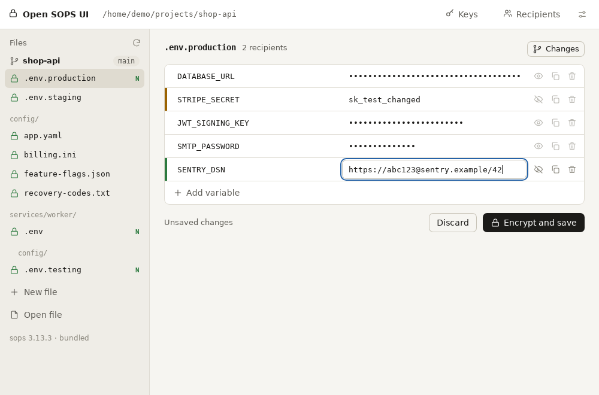
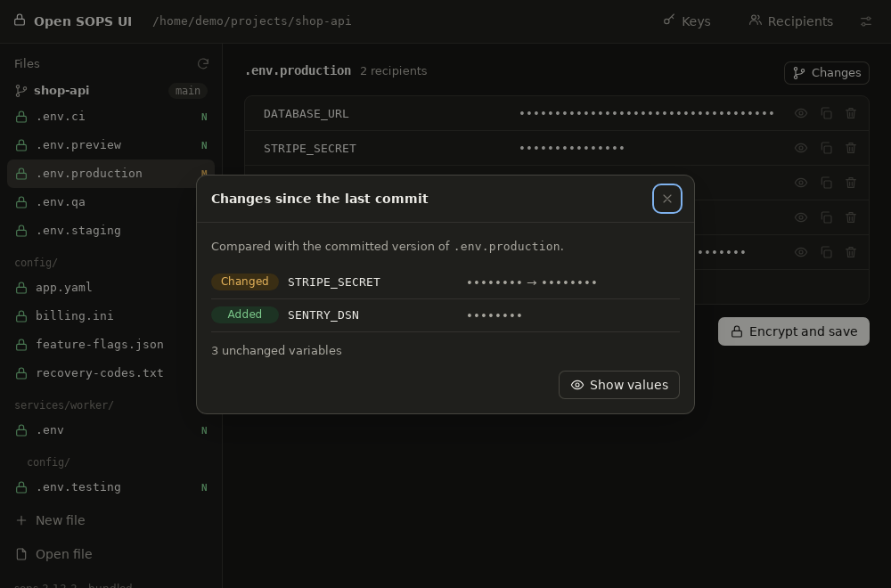
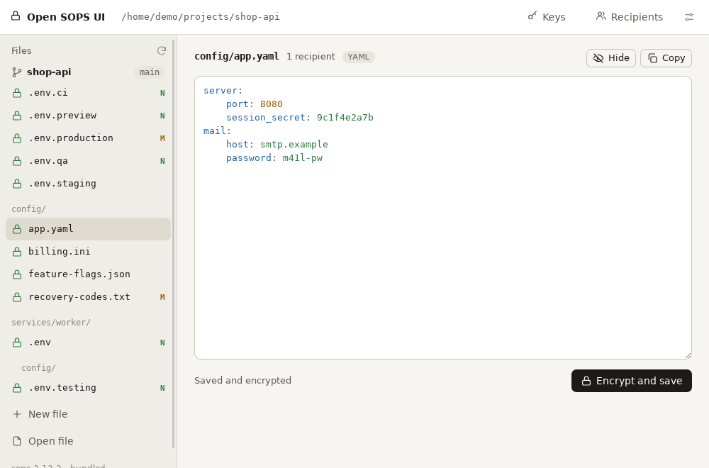

# Open SOPS UI

A desktop app for viewing, editing and encrypting files with [SOPS](https://github.com/getsops/sops) and age keys. Built with [Tauri](https://tauri.app) for Linux, Windows and macOS.

Decrypted values are held in memory only. The only network request the app makes is the optional update check, which reads the list of releases from GitHub.

<p align="center">
  
  
</p>
<p align="center">
  
</p>

## What it does

- Lists the SOPS-encrypted files in a folder, whatever their name: env, YAML, JSON and INI files, and any other text file sops encrypted as a whole. Files are recognised by their sops metadata; plaintext files aren't listed. It shows which of your keys opens each.
- Searches subfolders three levels deep by default and skips dependency and build folders such as `node_modules`; both are settings. A thin bar at the top of the file list shows when a scan takes a moment.
- Knows Git: files are grouped by repository with its branch, marked when they differ from the last commit, and a comparison shows what changed, decrypted, where `git diff` only shows ciphertext: by variable for env files, by line for everything else.
- Edits env files in a table and saves each change through `sops` on its own, so unchanged values stay byte-identical in Git and nothing decrypted is written to disk, not even to a temp file.
- Edits every other format as text, masked until you show it, with syntax colours for YAML, JSON, INI and TOML. A text file encrypted as a whole is saved in place; a YAML, JSON or INI file is encrypted again for the same recipients, keeping options such as `encrypted_regex`. Files also encrypted for PGP or a cloud KMS, or using options that only `.sops.yaml` can set (`mac_only_encrypted`, comment rules, several key groups), open read-only, because encrypting them again would lose those.
- Removes a copied value from the clipboard again after a time you choose in the settings (one minute by default).
- Creates new encrypted files: pick a folder and a name, fill in the content, and the file is written already encrypted. The name sets the format: env names get a table of variables, `.yaml`, `.json`, `.ini` and any other name a text editor.
- Tells you when a newer version is available: it checks GitHub's release list on start and once a day, and shows an icon next to the settings. A stable version only announces stable releases; a pre-release also announces newer pre-releases. You can turn the check off in the settings. Nothing is downloaded or installed automatically. The bottom of the settings links to the release page of your version, this repository, and the issue list for reporting a problem.
- Picks up changes made outside the app, such as a Git pull: the file list refreshes when you switch back to the window or press the refresh button, and an open file reloads unless you have unsaved edits.
- Asks before overwriting a file that changed on disk after you opened it, for example through a Git pull.
- Loads age keys from the default location, from any number of custom key files, or pasted for the session only. A pasted or newly created key can be saved to the default location.
- Manages who can decrypt a file, with a saved list of named public keys.
- Creates key pairs for other places that decrypt with sops, such as a server or a pipeline: the public key is saved as a recipient, and the private key is copied to the clipboard once and never stored by the app.
- The file list can be dragged wider for long file names; double-click its edge to reset it.
- Warns when a file's recipients differ from the matching `.sops.yaml` rule.
- Light and dark mode, following the system by default.

## Tested on

Every pull request and a weekly run install the app on these systems, click through it in its real window and check the result with `sops`:

| System | Versions |
| --- | --- |
| Windows | Windows Server 2025 (x64), which shares its web view with Windows 11 |
| macOS | 26 and 15, on Apple silicon and Intel |
| Debian | 12 and 13 |
| Ubuntu | 22.04, 24.04 and the current rolling release |
| Fedora | current release |

Other systems may work but aren't checked. The Linux packages need at least the library versions of Ubuntu 22.04 or Debian 12. Update this table together with the matrices in `.github/workflows/build.yml`.

## Install

1. Download the package for your system from the [releases page](https://github.com/nicostoe/open-sops-ui/releases). Each one comes in two variants:
   - `…-with-sops`: includes the official `sops` binary, nothing else to install.
   - without the suffix: uses the `sops` 3.11 or newer on your `PATH`. Get it from [github.com/getsops/sops/releases](https://github.com/getsops/sops/releases).
2. Install it:

   | OS | Package |
   | --- | --- |
   | Linux | `.deb`, `.rpm` or `.AppImage` |
   | macOS | `.dmg` |
   | Windows | `.msi` or `-setup.exe` |

3. Start "Open SOPS UI" from your app menu, or from a terminal with a project folder:

   ```bash
   open-sops-ui path/to/project
   ```

A `sops` binary shipped with the app is used first; otherwise the one on your `PATH`. A file named `sops` that merely sits in the same folder as an AppImage is ignored, so a stray download can't take its place.

Git is optional. Without a repository, or without `git` installed, the app works the same and simply shows no Git information. It never commits or pushes, and it never writes decrypted values to a file.

`age` and `age-keygen` aren't needed.

The packages aren't signed. macOS and Windows may warn on first start.

## Build

Needs [Rust](https://rustup.rs), Node.js 20 or newer, and the [Tauri system dependencies](https://tauri.app/start/prerequisites/). On Debian, Ubuntu or Mint:

```bash
sudo apt install -y libwebkit2gtk-4.1-dev libsoup-3.0-dev librsvg2-dev build-essential libssl-dev
```

Then:

```bash
npm install
```

```bash
npm run dev
```

```bash
npm run build
```

Tauri can't cross-compile: each system's package has to be built on that system (or in CI on a runner for it).

`.github/workflows/build.yml` does this on GitHub: it runs on pull requests, pushes to `main` and on demand, runs the tests described below, and attaches the packages for Linux, Windows and macOS to the workflow run as artifacts.

## Release

Pushing a version tag publishes a GitHub release with all packages, both variants, and a `SHA256SUMS.txt`:

```bash
git tag v0.1.0-beta.1 && git push origin v0.1.0-beta.1
```

A tag with a suffix after the version (`-beta.1`, `-rc.1`) is published as a pre-release; a plain `v0.1.0` as a normal release.

Each release lists what changed since the previous one: features, bug fixes and dependency updates, generated from the commit messages (`feat:` and `fix:` commits, and Renovate's `[renovate]` updates; internal work is left out). A pre-release covers the changes since the tag before it; a release covers everything since the last release, betas included. To see what the next release would contain:

```bash
scripts/release-notes.sh
```

An annotated tag's message opens the notes, to describe a release as a whole. A message that only repeats the tag name is left out:

```bash
git tag -a v2.0.0 -m v2.0.0 -m "What this release is about." && git push origin v2.0.0
```

The release runs the full build workflow first, so nothing is published unless every test passes.

The tag also sets the version compiled into the app (`scripts/version.sh`), which the update notice compares. The packages keep the plain `x.y.z`, because `.rpm` doesn't accept a pre-release in the version and `.deb` would sort a release below its own betas. Where a format has a separate field, it carries the pre-release: the `.rpm` release (`0.1.0-0.beta.4`, so `dnf` sorts betas before the release) and the `.msi`'s fourth number (`0.1.0.4`, a label only, as Windows compares the first three). Installing a newer beta `.deb` over an older one of the same base version may need `sudo apt install --reinstall ./file.deb`. The tag has to match `version` in `src-tauri/tauri.conf.json`, because the package file names come from there; for a new version, change that one line, commit, then tag.

The bundled `sops` version is pinned in `scripts/fetch-sops.sh`. The script verifies the release's checksums file with cosign and then the binary's SHA-256. [Renovate](https://docs.renovatebot.com) opens a pull request when a new `sops` release appears (`renovate.json`); the Renovate GitHub App has to be installed on the repository for that. `sops` is licensed under the MPL 2.0, and its licence text ships next to the binary.

## Test

Backend, against your installed `sops` with throwaway keys in a temp folder (skipped when `sops` isn't installed):

```bash
cargo test -p open-sops-ui-core
```

UI: the app clicks through itself in its real window, takes a screenshot at each stage, and the result is checked on disk with `sops`. It needs a display and, on Linux, ImageMagick for the screenshots:

```bash
node ui-tests/selftest.mjs target/release/open-sops-ui
```

Screenshots land in `ui-test-output/`. The test uses its own temp folders; your keys and config aren't touched.

CI runs this on every pull request and once a week:

| Check | Where |
| --- | --- |
| Backend against the pinned `sops` | Linux, Windows, macOS |
| Backend against the oldest supported `sops` (3.11.0) | Linux |
| Install the package, start the app, find the bundled `sops` | Ubuntu 22.04 (`.deb`, AppImage), Windows Server 2025, macOS 26 |
| UI test with screenshots in the installed app | the three above, plus macOS 15 (Apple silicon and Intel) |
| Install the package and run the UI test in a container | Debian 12 and 13, Ubuntu 22.04, 24.04 and rolling, Fedora (`.rpm`) |

Each run offers one `screenshots` artifact with the pictures from every platform, and its summary lists which platforms passed. A failed check repeats its error as an annotation on the run, readable without signing in.

The backend tests also run the app's logic with Git unavailable. Not covered by any test: native file dialogs, the `.msi` installer, and macOS or Windows versions older than the ones above.

## Keeping it up to date

- **Renovate** (`renovate.json`) opens pull requests as soon as it finds an update, without waiting for approval on the Dependency Dashboard; lock file maintenance runs on Mondays. It keeps them rebased on `main`, so their checks always reflect the current code. Minor and patch updates come as one grouped pull request and merge themselves once CI is green; so does a new `sops` release, in its own pull request. Major updates wait for a manual merge.
- **Audit** (`.github/workflows/audit.yml`) checks weekly for known vulnerabilities in the Rust and npm dependencies.
- For auto-merge to be safe, protect `main` on GitHub and make the four `Build` jobs required checks.

## Where things are stored

| OS | Default key file |
| --- | --- |
| Linux | `$XDG_CONFIG_HOME/sops/age/keys.txt` or `~/.config/sops/age/keys.txt` |
| macOS | `$XDG_CONFIG_HOME/sops/age/keys.txt` or `~/Library/Application Support/sops/age/keys.txt` |
| Windows | `%AppData%\sops\age\keys.txt` |

Custom key paths, saved recipients, recent folders and settings are stored in `open-sops-ui/config.json` next to the `sops` folder above. Secret keys are never written there.

## Limits

- Only the dotenv format and age keys are supported (no PGP or cloud KMS, no YAML or JSON files).
- Values are single-line; comments and blank lines are kept but not editable.

## License

[MIT](LICENSE).

The `-with-sops` packages also contain the official `sops` binary, which is licensed under the [MPL 2.0](https://github.com/getsops/sops/blob/main/LICENSE); its licence text is installed next to it.
